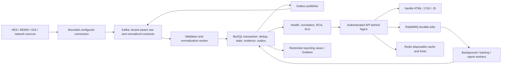

# GridSentinel architecture and implementation decisions

The initial deployable product is a customer-isolated AMI incident intelligence
pilot. A 10 million meter logical fleet is a design target, not measured capacity.
The deliverable separates domain correctness from infrastructure qualification.

## Service boundaries and data flow

Configuration, retry, logging, audit and authorization are constructor-injected
logical modules. Connector extraction, Kafka processing, job processing, log
collection and scheduling are independent process commands using the same image.
Incident calculation initially shares the telemetry transaction to avoid unsafe
dual writes. Independent sweeps handle silence and event-time maintenance.

MySQL records effects before Kafka offsets are committed. Outbox publishing may
repeat after lost acknowledgments. The contract is **at-least-once delivery with
idempotent effects**, never end-to-end exactly-once. Kafka topic partition keys
are stable meter/gateway/incident IDs. Cross-topic ordering is not assumed.

## Relational relationships

* tenants own users, roles, meters, devices, incidents, models, jobs and audit chains.
* users -> user_roles -> roles -> role_permissions -> permissions.
* user_sessions store token hashes and refresh families; refresh history detects reuse.
* meters -> meter_topology_history -> network_devices / regions. Effective ranges
  are checked under the meter lock; historical investigation joins event time.
* meter_current_health stores one current state per meter; interval delivery and
  communication state remain separate; aggregates have explicit time keys.
* incidents -> incident_evidence, incident_history, incident_actions.
* ml_training_runs -> ml_model_registry -> ml_predictions -> observed outcomes.
* event_deduplication and outbox_events participate in the processing transaction.
* background_jobs records durable operational state independently of broker delivery.
* audit_heads serialize a separate hash chain per tenant under a database row lock.

Composite tenant foreign keys protect relational ownership. Query predicates
include tenant IDs. Initial migrations are unpartitioned InnoDB with utf8mb4.
MySQL 8.4 does not support foreign keys on user-partitioned InnoDB tables. Future
partitioning requires separate fact-table and idempotency design; it is not
silently added to these transactional migrations.

## Scale and retention budget

Example sizing assumptions (replace with observed customer distributions):
48 interval events + 24 communication events per meter/day = 72 events/day.

| Logical fleet | Events/day | Average events/s | 5x burst events/s |
|---|---:|---:|---:|
| 100,000 | 7,200,000 | 83.3 | 416.7 |
| 1,000,000 | 72,000,000 | 833.3 | 4,166.7 |
| 5,000,000 | 360,000,000 | 4,166.7 | 20,833.3 |
| 10,000,000 | 720,000,000 | 8,333.3 | 41,666.7 |

At an assumed 700 serialized bytes/event, 10M meters produce 504 GB/day before
compression. Seven Kafka days at replication factor3 need about 10.584 TB before
segment/index/headroom overhead. The included single broker has replication1
and is a development topology, not a highly available production broker cluster.

Persisting every 15-minute interval for 30 days would mean 28.8 billion rows.
The pilot does not promise that this is economical in MySQL. Authorized sources
retain original telemetry; Kafka retains bounded replay history. MySQL retains
current health, selected normalized data, incident evidence, bounded intervals,
and aggregates. Source raw payload references are preserved where supplied.
No unapproved object-storage service is introduced.

One daily row per meter for 24 months means 7.3 billion rows at10M meters. Even
an assumed128 bytes/row is934 GB before indexes/replicas. Regional/gateway
aggregation and customer-selected per-meter detail are required at that scale.
Hourly per-meter retention cannot simply use laptop defaults at10M meters.

Caching a hot1% of meters (100K keys), with assumed512 byte value +200 byte key
and allocator overhead, costs about71.2 MB before Redis runtime/headroom.
Full-fleet cache would be7.12 GB before headroom. CPU, RAM and partition counts
must be measured; no hardware-throughput guarantees are inferred from these sums.

## Security boundary and unsafe constraints

Nginx terminates TLS and bounds headers, request bodies and rates. The Python
transport is internal, threaded with a finite connection budget and socket
timeouts. It is not equivalent to a hardened production web server. Direct
public exposure is unsupported. All business routes deny by default and check
permissions, tenant ownership and CSRF for cookie-authenticated mutations.
Opaque random tokens are hashed in MySQL; no custom JWT or TLS is implemented.

Security-sensitive changes and audit rows share a database transaction. Audit
heads serialize hash links. A chain stored in the same database cannot prove
integrity against a privileged database administrator; separately retained
anchors are required by customer policy. Grafana has separate authentication
and only explicitly granted reporting views; application RBAC does not flow
automatically into Grafana.

Development uses loopback-only HTTP and native MySQL authentication, and
unencrypted internal Kafka/RabbitMQ/Redis transport. Production configuration
must reject missing verified database/broker TLS. The production proxy override
alone is insufficient for production qualification. No production credentials
or private keys are committed.

## Models and customer definitions

Initial recovery baselines and logistic regression use the standard library.
Outcomes require observed communication recovery, not an operator simply closing
a case. Training excludes right-censored labels without a completed horizon,
uses point-in-time features and temporal holdouts, and records JSON coefficients,
schema versions, metrics and checksums. Approval and activation are separate
audited operations. Failure falls back to deterministic evidence or unknown.
Synthetic metrics are only implementation checks, not real-world accuracy.
Customer-approved SLA definitions and vendor alarm mappings are external inputs.

## Phase gates and measurable acceptance

1. Config precedence, immutable reload, redaction, bounded retries, pooling,
   rollback, migrations and health checks pass.
2. Password policy, hashed persistent sessions, expiry, rotation/reuse,
   revocation, tenant isolation, CSRF and permission-denial tests pass before
   ingest implementation is activated.
3. Strict envelopes, duplicates, late/order-independent health, checkpoint
   durability and invalid-event routing pass.
4. Historical topology, shared-failure evidence, separate MDMS health,
   incident transitions/history and contractual exclusions pass.
5. Temporal splits/censoring, deterministic fitting, corruption rejection,
   baseline comparison and audited activation pass.
6. Browser login, data loading, meter/incident drilldowns and workflow mutations
   work against the API. No demo numbers are substituted for failed fetches.
7. Restricted Grafana views and infrastructure operations are verified where run.
8. Integration/recovery tests and locally measured benchmarks are recorded.
   Customer load/failover/security acceptance remains a separate pilot gate.

See [verification evidence](VERIFICATION.md) and [delivery matrix](DELIVERY.md)
for executed checks and limits. No phase is complete solely because a file exists.
